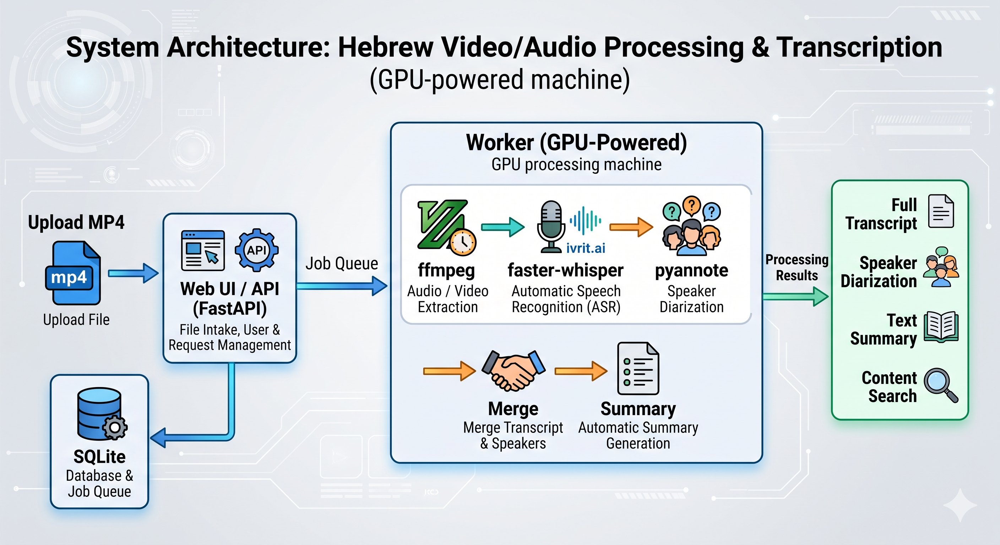

# מערכת תמלול וזיהוי דוברים בעברית — מכון פוע"ה

Eco System לקבלת הקלטות (mp4 ועוד), **תמלול בעברית** וזיהוי **דוברים** (diarization)
בתוך התמלול. המערכת כולה רצה **On-Prem** — שום הקלטה ושום תמלול אינם יוצאים מחוץ
לארגון, בהתאם לרגישות הגבוהה של השיחות.



## מה המערכת עושה

1. מקבלת הקלטת `mp4` (וגם `mov`, `m4a`, `mp3`, `wav`, `mkv`, `webm` ועוד) דרך ממשק Web.
2. מחלצת אודיו עם `ffmpeg`.
3. מתמללת בעברית עם מודל **ivrit.ai** (מבוסס Whisper, מהטובים בעברית) דרך `faster-whisper`.
4. מזהה **מי דיבר מתי** עם `pyannote.audio`.
5. ממזגת: מייחסת כל מילה/קטע לדובר לפי חפיפת זמנים, ומפיקה תמלול קריא עם תוויות דוברים.
6. **מסכמת אוטומטית** את השיחה (תקציר, נקודות עיקריות, פעולות והמשך טיפול, נושאים ומילות מפתח)
   באמצעות מודל שפה **מקומי** (Ollama / vLLM / LM Studio) — שום נתון לא יוצא החוצה.
7. מאפשרת צפייה, האזנה מסונכרנת, **שינוי שמות הדוברים** (למשל "דובר 1" → "יועץ"), וייצוא ל-TXT / SRT / VTT / JSON / **Word**.
8. **חיפוש מלא בכל התמלולים** (כולל טיפול בתחיליות עבריות) + **חיפוש והדגשה בתוך תמלול** + מילות מפתח לחיצות.
9. **מפיקה מסמך Word** לכל תמלול, ו**גרסה שעברה הסרת פרטים מזהים (PII)** עם **HebSafeHarbor** — נשמרת לקובץ נפרד (`*.pii`).
10. **מפיקה "סיכום ללקוח" ו"משוב ליועץ/רב"** לכל שיחה לפי הפרומפט הייעודי של פוע"ה (טהרת המשפחה, פוריות, הלכה),
    וניתנת לייצוא מצרפי ל-**Excel** (כמו `משוב_שיחות.xlsx`).
11. **מסך הגדרות** ⚙ — עריכת ה-System Prompts של הסיכומים ישירות מהממשק (עם שחזור לברירת מחדל),
    והוספת/החלפת **לוגו מימין ומשמאל** בכותרת. חיווי החיבור מוצג רק כשיש תקלה.
12. **RAG סמנטי + הערכת איכות** — אינדוקס ה-ground truth (`משוב_שיחות.xlsx`) עם embeddings מקומיים
    (bge-m3), והרצת הקלטות דרך המערכת כדי לאמת שהסיכום/המשוב שנוצר אכן מתאים סמנטית להקלטה הנכונה.

## ארכיטקטורה

| רכיב | תפקיד |
|------|-------|
| `app/main.py` | שרת FastAPI: העלאות, תור, תוצאות, ייצוא, הגשת ה-UI |
| `app/worker.py` | תהליך נפרד שמעבד את התור על ה-GPU (מודלים תושבים בזיכרון) |
| `app/pipeline/` | `audio` · `transcribe` (ivrit.ai) · `diarize` (pyannote) · `merge` · `summarize` (LLM) · `puah_prompts` · `export` · `export_docx` · `pii` (HebSafeHarbor) |
| `app/db.py` | תור ומצב משימות ב-SQLite (WAL) + אינדקס חיפוש מלא (FTS5 trigram) — ללא צורך ב-broker חיצוני |
| `web/` | ממשק Web בעברית (RTL), ללא שלב build |

ה-API וה-worker הם שני תהליכים נפרדים שחולקים את תיקיית `data/` ואת ה-DB.
ה-worker מעבד **משימה אחת בכל רגע** (ה-GPU הוא משאב סדרתי) כדי למנוע חריגת זיכרון.

## דרישות מקדימות

- **GPU** של NVIDIA + מנהלי התקן עדכניים (מומלץ; עובד גם על CPU, אך איטי).
- **Python 3.10–3.12** (מומלץ; 3.13 עשוי לדרוש התאמות בתלויות).
- **ffmpeg** ב-PATH. ב-Windows: `winget install Gyan.FFmpeg` או `choco install ffmpeg`.
- **טוקן HuggingFace** עם אישור תנאי השימוש של מודלי הזיהוי (ראו למטה).

### אישור מודל הזיהוי (חד-פעמי)

`pyannote` הוא מודל "gated". יש להיכנס עם חשבון HuggingFace ולאשר את התנאים בשני הדפים:

1. https://huggingface.co/pyannote/speaker-diarization-3.1
2. https://huggingface.co/pyannote/segmentation-3.0

ואז ליצור טוקן קריאה ב-https://huggingface.co/settings/tokens ולהכניסו ל-`.env` כ-`PUAH_HF_TOKEN`.

### מודל שפה מקומי לסיכום (אופציונלי אך מומלץ)

הסיכום האוטומטי משתמש במודל שפה דרך **ממשק תואם OpenAI** מקומי. הקל ביותר הוא **Ollama**
(התקנה מ-https://ollama.com).

**ברירת המחדל — Gemma 4.0 12B it** (אמין, נמשך מה-registry של Ollama):

```bash
ollama pull gemma4:12b      # ~8GB. רב-לשוני, עברית טובה, חלון הקשר 256K
```

| מודל | יתרון | `PUAH_LLM_MODEL` |
|------|-------|------------------|
| **Gemma 4.0 12B it** (ברירת מחדל) | אמין מהקופסה, רב-לשוני, חלון 256K | `gemma4:12b` |
| **DictaLM 3.0** (עברית-ייעודית) | איכות עברית מיטבית; דורש ייבוא ידני | `dictalm3` (לאחר ייבוא, ראו למטה) |

#### ייבוא DictaLM 3.0 ידני (אופציונלי, לאיכות עברית מיטבית)

> ⚠️ משיכה ישירה (`ollama pull hf.co/...`) של מודלי HuggingFace נכשלת כיום ב-`Error: EOF` עקב
> באג בלקוח של Ollama מול endpoint של HuggingFace (אומת: משיכה מ-registry של Ollama עובדת,
> מול HF נכשלת — לא בעיית רשת). העקיפה: להוריד את ה-GGUF ישירות ולייבא.

```powershell
# 1. הורדת קובץ ה-GGUF (curl.exe המובנה ב-Windows עוקף את הלקוח התקול של Ollama)
$base = "https://huggingface.co/dicta-il/DictaLM-3.0-Nemotron-12B-Instruct-GGUF/resolve/main"
curl.exe -L -o dictalm3-q4.gguf "$base/DictaLM-3.0-Nemotron-12B-Instruct-Q4_K_M.gguf"

# 2. יצירת Modelfile וייבוא ל-Ollama
"FROM ./dictalm3-q4.gguf" | Out-File -Encoding ascii Modelfile
ollama create dictalm3 -f Modelfile

# 3. ב-.env:  PUAH_LLM_MODEL=dictalm3
```

אם שרת ה-LLM אינו פעיל — התמלול עדיין יושלם, פשוט ללא סיכום (אפשר ליצור אותו אחר כך בלחיצה
על "צור סיכום"). לבדיקת זמינות: `GET /api/llm/status`. ודאו ש-Ollama פועל (`ollama serve` /
אפליקציית Ollama) לפני שמצפים לסיכום.

> **חשוב (Ollama):** ברירת המחדל של Ollama לחלון ההקשר היא 4096 טוקנים — קטן מדי לתמלול,
> והסיכום יחזור ריק. לכן הסיכום משתמש ב-API ה-native של Ollama (`/api/chat`) שמאפשר להגדיל
> את `num_ctx` (ברירת מחדל שלנו 16384) — ה-`/v1/chat/completions` התואם-OpenAI **מתעלם** מ-num_ctx.
> כן מכובה ה-reasoning של gemma4 (`think:false`) כדי לקבל פלט JSON ישיר.

> אפשר להשתמש גם ב-vLLM או LM Studio — כל שרת שחושף `/v1/chat/completions` מקומית. עדכנו
> את `PUAH_LLM_BASE_URL` בהתאם.

### ייצוא Word + הסרת PII

בסיום כל עיבוד, ה-worker מפיק אוטומטית (best-effort, לא חוסם):
- **מסמך Word** של התמלול: `data/results/{job_id}.docx` (כולל הסיכום, פריסת RTL).
- **גרסה שעברה הסרת פרטים מזהים (PII)** באמצעות **HebSafeHarbor**: `{job_id}.pii.json` ו-`{job_id}.pii.docx`
  (אותו שם + הסיומת `pii`). מנקה שמות, ת"ז, תאריכים, כתובות וכו' מהקטעים ומהסיכום.

ניתן להוריד גם מהממשק (כפתורי **Word** ו-**PII**) או דרך ה-API:
`GET /api/jobs/{id}/export?format=docx` · `GET /api/jobs/{id}/pii?format=json|docx`.

### סיכום ללקוח ומשוב ליועץ (פוע"ה)

לכל שיחה מופקים בנוסף שני תוצרים ייעודיים לפי הפרומפט של פוע"ה (מבוסס "פרומפט aistudio.google.docx"):
- **סיכום ללקוח** — טקסט אישי, חם ומכבד לשליחה לפונה, במבנה קבוע (70–200 מילים, ללא רשימות),
  כולל הכללים ההלכתיים שנאמרו בשיחה ונוסח אזהרה רפואית.
- **משוב ליועץ/רב** (פנימי) — ציון 1–5, נקודות לשימור, נקודות לשיפור והערת בטיחות מקצועית.

שניהם מופיעים בתצוגת התמלול (עם כפתורי העתקה), נכללים ב-Word וב-PII, וניתנים לייצוא מצרפי
ל-**Excel** (כמו `משוב_שיחות.xlsx`) מכפתור "ייצוא Excel" בדשבורד או `GET /api/export/feedback.xlsx`.

> את נוסח הפרומפטים ניתן לערוך **ישירות מהממשק** (מסך ⚙ הגדרות), עם שחזור לברירת מחדל. העריכות
> נשמרות ב-`data/prompts.json` ודורסות את ברירות המחדל שב-[`app/pipeline/puah_prompts.py`](app/pipeline/puah_prompts.py).
> תוצרים אלה דורשים שמודל השפה (Ollama) יהיה פעיל.

### RAG סמנטי והערכת איכות

[`app/rag.py`](app/rag.py) בונה אינדקס סמנטי מכל שורה ב-`משוב_שיחות.xlsx` (ground truth):
עמודה A = שם ההקלטה, B = סיכום ללקוח, C = משוב. ה-embeddings מחושבים **מקומית** דרך Ollama
(`bge-m3`, רב-לשוני עם עברית טובה) ונשמרים ב-`data/rag.db`.

```bash
ollama pull bge-m3                                    # פעם אחת
.venv\Scripts\python.exe scripts/eval_rag.py          # הערכה על כל ההקלטות שבתיקייה
.venv\Scripts\python.exe scripts/eval_rag.py --only-gt   # רק אלו שיש להן ground truth
```

[`scripts/eval_rag.py`](scripts/eval_rag.py) מריץ כל הקלטה דרך **אותו צינור** של המערכת
(תמלול → דוברים → סיכום ללקוח + משוב), שולף מה-RAG את הרשומה הדומה ביותר סמנטית, ובודק
האם היא מקושרת לאותה הקלטה. הקלטות ללא ground truth משמשות **בקרה שלילית**.

הפלט: `data/eval/report.html` (דוח קריא), `report.xlsx`, ו-`report.json`. מדדים: דיוק Top-1,
MRR, וההפרדה בין ציון התאמה נכונה לציון הבקרה השלילית. התמלולים נשמרים במטמון — הרצה חוזרת מהירה.

> ⚠️ **דרישת Python ל-PII:** HebSafeHarbor דורש pydantic<2 / spaCy 3.2, שמתנגשים עם האפליקציה
> (pydantic v2) ו-spaCy 3.2 תומך רק ב-**Python 3.8–3.10**. לכן הוא מותקן ב-venv **מבודד** (`.venv-pii`)
> ונקרא כתת-תהליך. `rebuild.py` מאתר אוטומטית Python 3.8–3.10 ובונה את `.venv-pii`; אם אין כזה —
> הסרת ה-PII מדולגת (הכול אחר עובד). להתקנה: `winget install Python.Python.3.10` ואז `python rebuild.py`
> (או `--pii-python <path>`). התקנה ידנית:
> ```powershell
> py -3.10 -m venv .venv-pii
> .venv-pii\Scripts\python -m pip install -r requirements-pii.txt
> ```

---

## הפעלה מהירה — פקודה אחת ⭐

```bash
python rebuild.py
```

זהו. הסקריפט עושה את הכול אוטומטית:
1. יוצר סביבת `.venv` ומתקין את כל התלויות (torch+CUDA ו-requirements) — **רק בפעם הראשונה**.
2. יוצר `.env` מתוך הדוגמה אם חסר, ובודק ffmpeg ו-Ollama (אזהרות אם חסרים).
3. מפעיל את ה-worker ואת שרת ה-API, ופותח דפדפן ב-**http://localhost:8000**.

בהרצות הבאות הוא מדלג על ההתקנה ועולה תוך שניות. לעצירה: `Ctrl+C`.

**לפני ההרצה הראשונה** מומלץ: להתקין ffmpeg, להגדיר `PUAH_HF_TOKEN` ב-`.env` (לזיהוי דוברים),
ולהריץ `ollama pull` של מודל הסיכום. הסקריפט יזהיר על כל אחד מהם אם חסר — אבל המערכת תעלה בכל מקרה.

דגלים: `--reinstall` · `--cpu` (torch ל-CPU) · `--skip-install` · `--offline` (מנותק-רשת) · `--no-browser` · `--port 8000`

> בהרצה הראשונה ה-worker יוריד את המודלים (כמה GB). זה קורה פעם אחת ונשמר במטמון.

> 🚀 **לפריסת שרת ייצור** (הרצה כשירות, reverse proxy, אבטחה, גיבוי, **GCP**, Docker) — ראו
> **[DEPLOYMENT.md](DEPLOYMENT.md)** + קבצים מוכנים תחת [`deploy/`](deploy/)
> (systemd · nginx · [startup-script ל-GCP](deploy/gcp/startup.sh)).

---

## התקנה ידנית — Windows (מקומי, עם GPU)

לחלופין, ידנית בשני חלונות:

```powershell
# 1. הקמה (יוצר venv, מתקין torch+CUDA ואת התלויות, יוצר .env)
.\scripts\setup.ps1

# 2. ערכו את .env והכניסו את PUAH_HF_TOKEN

# 3. חלון PowerShell ראשון — ה-worker (מעבד על ה-GPU):
.\scripts\run-worker.ps1

# 4. חלון PowerShell שני — שרת ה-API + הממשק:
.\scripts\run-api.ps1
```

פתחו בדפדפן: **http://localhost:8000**

## הפעלה מנותקת-רשת (Air-Gapped) 🔒

**בזמן ריצה — עיבוד ההקלטות — שום נתון אינו יוצא מהשרת.** כל ההסקה מקומית: תמלול (ivrit.ai),
זיהוי דוברים (pyannote), סיכום/סיכום-לקוח/משוב (Ollama), והסרת PII (HebSafeHarbor). הממשק מוגש
מהשרת ללא CDN/פונטים חיצוניים.

הרשת נדרשת **פעם אחת בלבד** — בהתקנה — להורדת חבילות ומודלים. לאחר מכן ניתן לנתק את השרת לגמרי.

**הפעלה מנותקת (לאחר שהמודלים כבר במטמון):**
```bash
python rebuild.py --offline
```
הדגל `--offline` מדלג על כל ההתקנות ומגדיר `HF_HUB_OFFLINE=1` ו-`TRANSFORMERS_OFFLINE=1` — כך
ספריות HuggingFace משתמשות אך ורק במטמון המקומי ואינן מנסות לפנות לרשת (אפילו לא לבדיקת עדכון).

**העברה לשרת מבודד פיזית** (התקנה על מכונה מחוברת, ואז העתקה):
1. במכונה מחוברת: `python rebuild.py` (מוריד הכול), והעלו הקלטה אחת כדי לוודא שכל המודלים נמשכו למטמון.
2. העתיקו לשרת המבודד את: `.venv/`, `.venv-pii/`, את מטמון HuggingFace (`%USERPROFILE%\.cache\huggingface`
   או `~/.cache/huggingface`), ואת מודלי Ollama (`%USERPROFILE%\.ollama` / `~/.ollama`), וכן את קוד הפרויקט.
3. בשרת המבודד הפעילו את Ollama, ואז: `python rebuild.py --offline --skip-pii` (או בלי `--skip-pii`
   אם `.venv-pii` הועתק). לא נדרש אינטרנט.

> אין בפרויקט טלמטריה. Ollama אינו שולח נתונים בעת הסקה. עם `--offline` אין אף קריאת רשת יוצאת.

## התקנה והרצה — Docker / Linux (פריסת ייצור)

דורש `nvidia-container-toolkit` מותקן על המארח.

```bash
cp .env.example .env          # ערכו והכניסו PUAH_HF_TOKEN
docker compose up --build -d  # מריץ api + worker
```

הממשק יהיה זמין ב-`http://<כתובת-השרת>:8000`.

## הגדרות (`.env`, קידומת `PUAH_`)

| משתנה | ברירת מחדל | הסבר |
|-------|-----------|------|
| `PUAH_HF_TOKEN` | — | טוקן HuggingFace (חובה לזיהוי דוברים) |
| `PUAH_ASR_MODEL` | `ivrit-ai/whisper-large-v3-turbo-ct2` | מודל התמלול. לדיוק מרבי: `ivrit-ai/whisper-large-v3-ct2` |
| `PUAH_DEVICE` | `auto` | `cuda` / `cpu` / `auto` |
| `PUAH_COMPUTE_TYPE` | `auto` | `float16` (GPU) / `int8` (CPU) / `auto` |
| `PUAH_DEFAULT_NUM_SPEAKERS` | (ריק) | רמז למספר דוברים; ריק = זיהוי אוטומטי |
| `PUAH_SUMMARY_ENABLED` | `true` | יצירת סיכום אוטומטי בסוף העיבוד |
| `PUAH_LLM_BASE_URL` | `http://localhost:11434/v1` | כתובת שרת מודל השפה (תואם OpenAI) |
| `PUAH_LLM_MODEL` | `gemma4:12b` | שם המודל לסיכום (`gemma4:12b` / `dictalm3` לאחר ייבוא) |
| `PUAH_LLM_PROVIDER` | `ollama` | `ollama` (native, שולט ב-num_ctx) או `openai` (vLLM/LM Studio) |
| `PUAH_LLM_NUM_CTX` | `16384` | חלון הקשר — ה-default של Ollama (4096) קטן מדי לתמלול! |
| `PUAH_LLM_THINK` | `false` | כיבוי "חשיבה" של gemma4 (פלט ישיר) |
| `PUAH_WORD_EXPORT_ENABLED` | `true` | יצירת מסמך Word לכל תמלול |
| `PUAH_PII_ENABLED` | `true` | הסרת PII ושמירת גרסה מנוקה (`*.pii`) |
| `PUAH_PII_VENV` | `.venv-pii` | סביבת ה-venv המבודדת של HebSafeHarbor |
| `PUAH_CLIENT_SUMMARY_ENABLED` | `true` | הפקת "סיכום ללקוח" לכל שיחה |
| `PUAH_FEEDBACK_ENABLED` | `true` | הפקת "משוב ליועץ/רב" לכל שיחה |
| `PUAH_EMBED_MODEL` | `bge-m3` | מודל ה-embedding ל-RAG הסמנטי |
| `PUAH_MAX_UPLOAD_MB` | `2048` | גודל העלאה מרבי |
| `PUAH_DATA_DIR` | `data` | תיקיית האחסון המקומית |

## ה-API (REST)

| פעולה | נתיב | תיאור |
|-------|------|-------|
| `POST` | `/api/jobs` | העלאת קובץ (`file`, אופציונלי `num_speakers`) → יוצר משימה |
| `GET` | `/api/jobs` | רשימת כל המשימות וסטטוסן |
| `GET` | `/api/jobs/{id}` | סטטוס + התקדמות של משימה |
| `GET` | `/api/jobs/{id}/result` | תמלול מלא (JSON) עם דוברים וסיכום |
| `PUT` | `/api/jobs/{id}/speakers` | שינוי שמות הדוברים |
| `POST` | `/api/jobs/{id}/summarize` | יצירה/רענון של הסיכום האוטומטי |
| `GET` | `/api/search?q=...` | חיפוש מלא בכל התמלולים |
| `GET` | `/api/llm/status` | זמינות שרת מודל השפה |
| `GET` | `/api/jobs/{id}/export?format=txt\|srt\|vtt\|json\|docx` | הורדת התמלול (כולל Word) |
| `GET` | `/api/jobs/{id}/pii?format=json\|docx` | הורדת הגרסה שעברה הסרת PII |
| `GET` | `/api/stats` | סטטיסטיקות לדשבורד |
| `GET` | `/api/export/feedback.xlsx` | ייצוא Excel מצרפי: סיכום ללקוח + משוב לכל ההקלטות |
| `GET`/`PUT` | `/api/prompts` | קריאה/עדכון של פרומפטי הסיכומים (`POST /api/prompts/reset` לשחזור) |
| `GET`/`POST`/`DELETE` | `/api/branding/{right\|left}` | לוגו כותרת (הצגה/העלאה/הסרה) |
| `GET` | `/api/jobs/{id}/media` | קובץ המקור (לנגן) |
| `DELETE` | `/api/jobs/{id}` | מחיקת המשימה והקבצים |

דוגמה (העלאה דרך CLI):

```bash
curl -F "file=@meeting.mp4" -F "num_speakers=2" http://localhost:8000/api/jobs
```

## בדיקות

```bash
python tests/test_merge.py           # לוגיקת מיזוג דוברים (ללא GPU)
python tests/test_search_summary.py  # חיפוש FTS עברי + עיבוד סיכום (ללא GPU/LLM)
python tests/test_export_pii.py      # ייצוא Word + מיפוי הסרת PII (ללא HebSafeHarbor)
python tests/test_rag.py             # RAG סמנטי — אינדוקס ושליפה (embeddings ממוקים)
python tests/test_api.py             # מסלול ה-API המלא: העלאה→תוצאה→חיפוש→סיכום→ייצוא (ללא GPU)
```

## דיוק וכוונון

- **דיוק תמלול:** למקסימום דיוק החליפו ל-`ivrit-ai/whisper-large-v3-ct2` (איטי יותר).
- **דיוק דוברים:** אם ידוע מספר הדוברים — ציינו אותו בהעלאה; זה משפר משמעותית את הזיהוי.
- **שיחות טלפון/איכות נמוכה:** הזיהוי רגיש לרעש וחפיפות דיבור; ציון מספר דוברים עוזר.

## פתרון תקלות

- **`ffmpeg לא נמצא`** — התקינו ffmpeg והוסיפו ל-PATH.
- **שגיאת טעינת מודל pyannote** — ודאו שאישרתם את **שני** הדפים וש-`PUAH_HF_TOKEN` תקין.
- **`cuDNN`/`CUDA` ב-faster-whisper** — התאימו את גרסת `ctranslate2`/`torch` ל-CUDA המותקן.
  ב-Docker תמונת הבסיס כבר כוללת CUDA 12.4 + cuDNN.
- **המשימה "תקועה" ב-processing** — הפעלת ה-worker מחדש מחזירה משימות תקועות לתור אוטומטית.

## פרטיות

כל הרכיבים רצים מקומית. ההקלטות, האודיו המחולץ והתמלולים נשמרים אך ורק תחת `data/`
על השרת שלכם. מומלץ להצפין את הדיסק ולהגדיר מדיניות שמירה/מחיקה בהתאם לנהלי הארגון.
